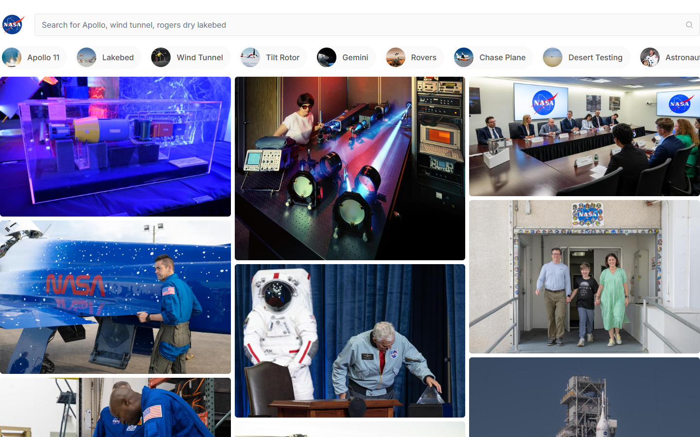

# NASA Image Viewer

A fun side project to make exploring the [NASA Image and Video Library](https://images.nasa.gov) a bit easier. The archive is enormous and wonderful, but hard to wander through. This app puts it in a fast, browsable masonry gallery so you can follow your curiosity from one image to the next.



## Features

- **Search and browse** the NASA archive from a masonry gallery, with quick category pills (Apollo 11, Wind Tunnel, Rovers, and more) to jump straight into a topic.
- **Magnifying glass** for looking at small details. Open an image in the lightbox, turn on the glass, scroll to zoom and Ctrl + scroll to resize the lens. A minimap shows where you are in the image.
- **Related image gallery** built from the keywords each image contains, so you can keep exploring from whatever you are looking at.
- **Infinite scrolling** so results keep loading as you go. No pagination buttons.

## Tech stack

- [SvelteKit](https://svelte.dev/docs/kit) and Svelte 5
- [Tailwind CSS](https://tailwindcss.com) v4
- TypeScript
- Deployed on Cloudflare (`adapter-cloudflare`), with NASA responses cached at the edge
- Tested with [Vitest](https://vitest.dev) and [Playwright](https://playwright.dev)

Data comes from the public [NASA Image and Video Library API](https://images.nasa.gov/docs/images.nasa.gov_api_docs.pdf), which does not need an API key.

## Getting started

You need Node 22.17 or newer and [pnpm](https://pnpm.io).

```bash
pnpm install
pnpm dev
```

Then open the URL that Vite prints (usually http://localhost:5173).

### Other scripts

| Command          | What it does                 |
| ---------------- | ---------------------------- |
| `pnpm build`     | Production build             |
| `pnpm preview`   | Preview the production build |
| `pnpm check`     | Type-check with svelte-check |
| `pnpm lint`      | Prettier and ESLint          |
| `pnpm test:unit` | Unit tests                   |
| `pnpm test:e2e`  | End-to-end tests             |

## Credits

All imagery belongs to NASA and is provided through the NASA Image and Video Library. This is an unofficial fan project and is not affiliated with or endorsed by NASA.
